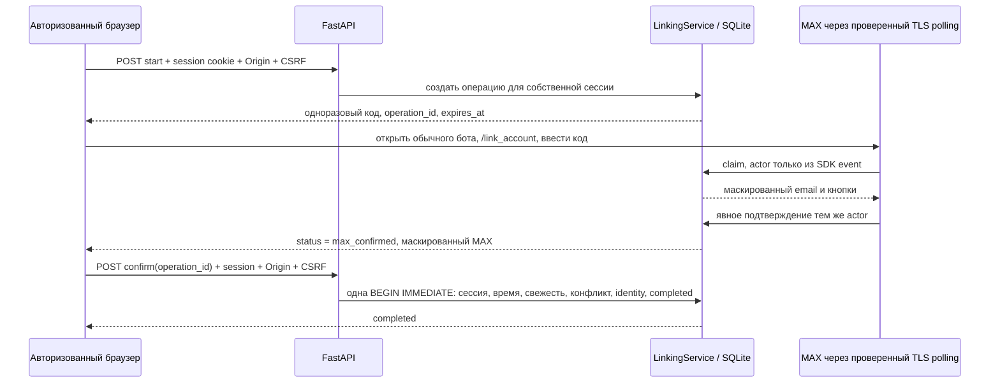
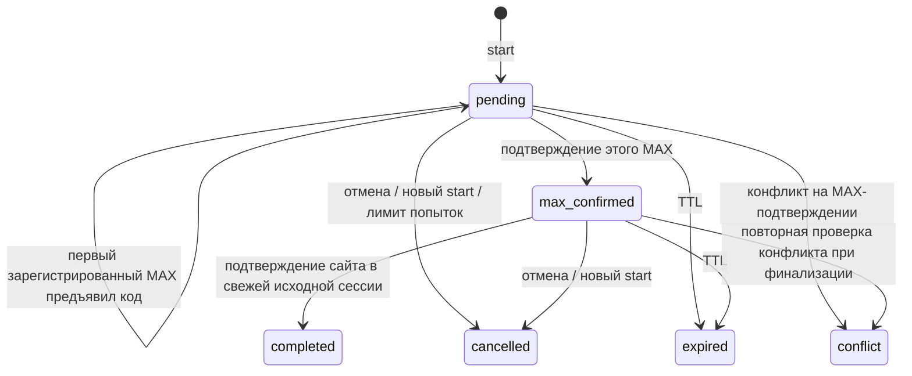

# Этап 1.2Б — безопасная привязка MAX к веб-аккаунту

Зависимый PR: ветка `feature/web-max-linking` основана на `feature/web-auth-api`, проверенный HEAD `ecf16597c71c3c2165bfc5145695b975a09ce9cd`. Ветки backend не слиты; frontend `feature/web-frontend` / PR #257 не затронут. Это реализация backend и отдельного MAX-адаптера, без deployment.

## Архитектура и границы доверия

- `account_linking/service.py` — внутренний интерфейс бизнес-операций; не зависит от HTTP, SDK или FSM.
- `repository.py` — короткие транзакции и постоянные бюджеты. Использует доверенный внутренний `AccountRepository._insert_identity` на **том же соединении**, без вложенного `commit` или сети.
- `models/security/settings/errors/schema.py` — значения, HMAC, ограничения и миграция.
- `max_adapter.py` / `bootstrap.py` — необязательный транспортный сценарий; подключается раньше продуктового fallback-router.
- `web_api/routes/linking.py` — HTTP-адаптер существующих cookie/Origin/CSRF/JSON-защит.

HTTP не принимает MAX ID, account_id, VerifiedIdentity или время подтверждения. Владельца определяет действующая cookie-сессия. MAX ID берётся только из `MessageCreated.message.sender` либо `MessageCallback.callback.user`, с проверкой SDK-типа, личного диалога, `is_bot=False` и согласованности `get_ids()`. Отправитель сообщения с кнопкой в callback — бот, он не считается пользователем операции. HTTP-маршрута для приёма MAX-событий нет.

Доверенный транспорт — действующий long polling с bot token. В прежнем клиенте MAX было `ssl=False`. Для включённой привязки `bot.main` требует `verify_ssl=True`: проверяются сертификат и hostname. Без этого считать события подтверждением владения было бы небезопасно. При выключенном флаге прежнее транспортное поведение не меняется. Сбой сертификата при включённой привязке нельзя исправлять отключением проверки: сначала необходим корректный доверенный транспорт.

Знание MAX ID не подтверждает личность. Сам код не является email OTP или сессионным токеном и не позволяет войти на сайт. Установка MAX-идентичности не выдаёт веб-сессию и не открывает legacy-заказы, фотографии или финансы.

## Подтверждения и свежесть

1. Войти по email, затем запросить код на сайте.
2. Открыть действующий адрес `https://max.ru/se14596751_1_bot` без параметров. Формат нового MAX deep link не предполагается.
3. В личном диалоге отправить `/link_account`, затем код одним сообщением.
4. Проверить маскированный email и предупреждение, нажать подтверждение в MAX.
5. На сайте получить `max_confirmed`, проверить маскированный MAX ID и отдельно нажать окончательное подтверждение.

Выбрана **свежая email-авторизация той же веб-сессии**, а не новый email OTP в linking-модуле. И start, и финализация требуют `now - auth_sessions.created_at < 300 секунд`; это timestamp серверного успешного email-входа. Проверка повторяется **после получения SQLite write-lock**, вместе с проверкой session_id/account_id, revoked_at, hard/idle expiry. `last_seen_at` не заменяет подтверждение email.

Код действует 600 секунд, но финальное подтверждение дополнительно ограничено пятиминутной свежестью входа. Если окно свежести закончилось: выйти, войти по email заново и создать **новую** операцию. Новая сессия не может завершить старую операцию, даже если принадлежит тому же аккаунту. Фоновый polling статуса не продлевает свежесть. Будущий кабинет должен объяснить обе границы пользователю; frontend в этом PR не реализуется.

Сначала ввод кода фиксирует первого MAX-кандидата, но состояние остаётся `pending`. Только явная кнопка меняет его на `max_confirmed`. Только отдельный POST с сайта создаёт идентичность. На сайтах/в MAX нельзя показывать «аккаунты связаны» до `completed`.

## Состояния

Отдельный `max_review` не нужен: кандидат хранится в max_user_id/max_claimed_at, а max_confirmed_at остаётся NULL до кнопки. Терминальные состояния не возвращаются в pending. Повторный финал в той же живой свежей сессии идемпотентно возвращает completed; он не создаёт вторую identity. Отмена completed не отвязывает MAX.

Срок проверяется при каждом обращении; истечение записывается лениво при следующей операции. Повторный start отменяет все незавершённые операции того же аккаунта, включая другую его сессию. Подтверждение содержит operation_id, поэтому устаревшая вкладка не подтвердит незаметно новую операцию.

## Коды, лимиты и хранение

- 16 криптографически случайных символов из алфавита на 32 символа без 0/1/I/O; **80 бит** энтропии. Представление `XXXX-XXXX-XXXX-XXXX`. Регистр и дефисы нормализуются.
- Отдельный `ACCOUNT_LINKING_SECRET` ≥32 байт, отличный от email auth secret. HMAC-SHA256 с назначениями `max-link-code-v1`, `max-link-source-v1`, `max-link-max-v1`, `max-link-account-v1`.
- Открытый код возвращается **один раз** в start-response с `no-store`; его нет в status, URL, БД, FSM-данных и диагностике. В MAX не эхоится введённый код. Браузер не должен отправлять его аналитике.
- Уникальный индекс HMAC защищает от коллизий, включая сохранённые завершённые операции; максимум 8 попыток выделения нового кода. При невозможности выделения безопасный отказ, старая операция не перезаписывается.
- Первый допустимый MAX-кандидат неизменяем. Другой actor не может заменить его callback-ом или повторной отправкой кода.
- SQLite `account_link_limits` сохраняет бюджеты между перезапусками и между HTTP/MAX процессами. Неуспешные проверки зарегистрированного MAX расходуют actor/global бюджет. Ошибки не выбрасываются до commit счётчиков.

Значения по умолчанию за час:

| Ограничение | Лимит |
| --- | ---: |
| start по account / IP источнику / глобально | 5 / 20 / 1000 |
| действия сайта по account / источнику / глобально | 100 / 200 / 10000 |
| попытки MAX по actor / глобально | 20 / 5000 |
| предъявления одного найденного кода | 5 |

Неверный неизвестный код нельзя отнести к операции без публичного идентификатора: его ограничивают MAX/global бюджеты; найденный код дополнительно ограничен attempts. Не зарегистрированный legacy MAX отклоняется до проверки кода. Источник HTTP определяется существующим `client_source`, а не клиентским X-Forwarded-For. IP/account/actor в таблице лимитов хранятся как HMAC, кроме константы global. Старые записи лимитов удаляются только после полного окна.

Ни ключи, ни коды не нужно журналировать на reverse proxy, APM или в payload/debug-логах SDK. Одноразовый код остаётся в истории самого диалога MAX: это ограничение ручного ввода; не пересылать его и не вводить полученные от других людей коды. При утечке до истечения TTL возможен отказ в обслуживании операции/социальная инженерия. Предупреждения, маскированные идентификаторы и отдельное подтверждение на сайте снижают риск, но не заменяют внимательность пользователя.

## Миграция v4

`account_linking/schema.py`: `account_link_operations`, `account_link_limits` и индексы. DDL и checksums **v1, v2, v3 не менялись**. Изменён только реестр версий мигратора. Нет ALTER legacy-таблиц, обновления балансов или создания users.

Хранятся operation/account/session IDs, HMAC кода, created/expiry, attempts, MAX-кандидат и timestamps claim/confirm, completed/invalidated timestamp, state и константная безопасная причина отказа. По account_id — FK RESTRICT. session_id намеренно без FK: auth cleanup может удалить старую сессию; операции от этого не становятся доступными, поскольку финал требует существующую актуальную сессию.

Миграция никогда не запускается импортом, startup бота или FastAPI. Используется существующий явный `accounts.migrate` с `--apply`; без этого ключа только read-only preflight. В этой задаче применялась только к временным синтетическим базам. Применение к рабочему серверу — отдельное согласование.

Операции сохраняются для разбора отказов. Отдельную политику хранения/удаления этого аудита необходимо согласовать до включения в production; в этом этапе нет фонового удаления identity или аккаунтов. Можно отключить feature flags без отката миграции.

## Конфликты и гонки

| Ситуация | Результат |
| --- | --- |
| MAX ещё не имеет account identity | Добавление после двух подтверждений |
| MAX уже у этого же аккаунта | Идемпотентная успешная финализация |
| MAX у другого аккаунта | conflict; никаких сведений о другом владельце |
| У веб-аккаунта другой MAX | conflict; не заменять |
| Два MAX вводят один код | Первый кандидат закреплён, второй отклонён |
| Два аккаунта подтверждают один MAX | BEGIN IMMEDIATE + уникальный индекс: один completed, второй conflict |
| Logout/revoke до захвата финальным запросом lock | Финал отклонён |
| Logout после фиксации финала | Линеаризуется после завершённой операции; будущие запросы сессии запрещены |
| Старый запрос / другая сессия / другой account | Отказ без доступа к операции |
| Ошибка после INSERT identity | Rollback identity и completed вместе |
| Отмена одновременно с финалом | Один последовательный исход: cancelled без identity либо completed с identity |

Приватная операция `_insert_identity` повторно проверяет legacy user и уникальность на том же соединении. Никаких get_or_create_max_account перед привязкой: это создало бы искусственный второй аккаунт и конфликт.

## HTTP-контракт

Все ответы `Cache-Control: no-store`, безопасные JSON-ошибки, body limit из существующего middleware (по умолчанию 4096 байт), строгие Pydantic-модели с `extra=forbid`. Для mutations обязательны Origin и session-bound X-CSRF-Token. Query-параметры отвергаются. OpenAPI: `docs/web-auth-openapi.json`, security schemes обновлены для новых маршрутов.

| Метод / маршрут | Запрос | Результат |
| --- | --- | --- |
| GET /api/v1/account/identities | session cookie | Только provider + verified; работает и при выключенной привязке |
| POST /api/v1/account/max-link/start | `{}` | operation, одноразовый code, bot_url без секретов, command |
| GET /api/v1/account/max-link/status | session cookie | Последняя operation этой сессии либо null; без кода |
| POST /api/v1/account/max-link/confirm | `{operation_id}` | Финальное состояние операции |
| POST /api/v1/account/max-link/cancel | `{operation_id}` | Отмена / уже терминальное состояние |

Operation: operation_id, status, expires_at, max_confirmed, max_hint (только последние 4 цифры, только после MAX-confirm). Email/MAX ID полностью не публикуются. Состояние conflict безопасное, одинаковое для конфликтов разных владельцев.

Ошибки: `link_denied` 400; `fresh_auth_required` 403; `link_rate_limited` 429; `link_unavailable` 503; `linking_disabled` 503; существующие unauthenticated/csrf_denied/origin_denied/invalid_request и ошибки хранилища сохраняются. У GET identities нет зависимости от таблиц v4.

## MAX-адаптер и включение

- `MAX_ACCOUNT_LINKING_ENABLED=false` по умолчанию. Ни новых кнопок в старом меню, ни новых обработчиков, ни обращений к account/auth/linking-таблицам. В отсутствие v1–v4 основной бот работает прежним образом.
- `WEB_MAX_LINKING_ENABLED=false` по умолчанию. Новые mutations/status недоступны; email вход, /me и identities продолжают работать.
- Оба процесса должны использовать один и тот же отдельный ACCOUNT_LINKING_SECRET и согласованную SQLite-базу. MAX берёт путь существующего `database.DATABASE_PATH`; WEB_API_DATABASE при будущем запуске должен указывать на ту же выбранную базу. Никакого автоматического копирования/слияния БД нет.
- Шаблон настроек: `docs/web-max-linking.env.example` (flags выключены; секрет отсутствует).

Сценарий входа — `/link_account`, код отдельным сообщением, кнопки MAX confirm/cancel. `/cancel_link` закрывает ввод, не отменяя молча операцию на сайте. Предыдущий FSM-state и продуктовые данные сохраняются; после ввода/отмены state восстанавливается. После перезапуска бота операция остаётся в SQLite, но ввод кода можно открыть повторно командой. Кнопки подтверждения работают по закреплённому actor/op ID, а не по данным памяти. Возврат к главному экрану использует существующий callback.

Автоматическая регистрация MAX-пользователя, массовое создание account mapping, начисление бонусов/кредитов/триала в адаптере отсутствуют. Если legacy user отсутствует, предлагается обычный /start; только этот прежний штатный сценарий регистрирует пользователя.

До запуска отдельно проверить работу проверенного TLS, миграцию на согласованном окружении, секреты, backup/runbook, abuse monitoring без payload, UI подтверждений и юридические сроки хранения. Здесь ничего из этого на production не выполнялось.

## Исправление межбраузерной инвалидации email OTP

Ранее request_email_code аннулировал все коды email, включая чужой browser context. Теперь:

1. Браузерный запрос аннулирует только предыдущие challenges **своего context**, в том числе для другого email в этой же вкладке/браузере.
2. Legacy-вызов без context аннулирует только legacy unbound challenges; он не может подтвердить браузерный challenge.
3. Запрос другого браузера не аннулирует первый. После успешного email-доказательства все оставшиеся challenges этого email безопасно закрываются; уже выданные сессии остаются действующими.
4. Неверная browser binding не тратит индивидуальный или email-бюджет чужого challenge. Source/global бюджеты всё равно расходуются.
5. Email/source/global ограничения, resend interval и общий email attempt budget сохранены; resend и смена браузера не обнуляют попытки.
6. Дополнительный лимит активных challenges: 3 на email, 1000 глобально. BEGIN IMMEDIATE сериализует конкурентные запросы. Старые DDL/checksums не менялись — используется существующая схема и новые настройки лимитов.

Остаточный риск доступности: общий email cooldown/quota, общие лимиты и cap активных браузеров могут исчерпываться злоумышленником. Это не отменяет чужой код и не даёт войти, но может задержать получение нового кода. Дальнейшее снижение: контролируемое rate limiting на edge по надёжному source, адаптивный anti-abuse/CAPTCHA, мониторинг аномалий без PII, отдельная очередь доставки и квоты по отправителю. Нельзя просто ослаблять общий бюджет попыток или раскрывать существование account.

## Проверки и регрессии

Все БД временные, аккаунты/платежные записи синтетические, почта FakeEmailSender/SMTP mock, MAX — синтетические SDK events с AsyncMock. Внешняя сеть для pytest блокируется отдельным внешним harness, разрешён только loopback для локальных тестовых серверов; MAX_BOT_TOKEN заменён синтетическим. Ветка baseline проверена тем же interpreter/harness/настройками.

- Исходные 227 целевых тестов на ecf1659: **227 passed**.
- Целевой набор после изменений, включая 79 новых тестов: **306 passed**.
- Ожидание старого теста `MAX(version)==3` обновлено до 4; проверки неизменности v1/v2 и legacy-строк сохранены. Контракт OpenAPI перегенерирован офлайн.
- Покрыты браузеры/legacy, активные caps, общие бюджеты, неверные/истёкшие коды, key collisions, два подтверждения, подмена actor/account/session, logout/revoke/freshness, CSRF/Origin/body limits, конфликты, гонки MAX и финала, ожидание write-lock, rollback после INSERT, повторное завершение, отсутствие финансовых side effects, выключенные flags и проверенный TLS.

Полный сравнительный прогон и точный список baseline failures приводятся в приложенном отчёте проверки. Наличие этих ошибок означает, что полный прогон **не является зелёным**, даже если новых регрессий нет. Ранее сообщённые 3438 passed / 6 failed не подменяют фактический результат повторного baseline-прогона этой задачи.

## Дальнейшие этапы — только после отдельного разрешения

1. Подключить подтверждённые связи к кабинету; привязка остаётся необязательной для email-пользователя.
2. Спроектировать единый ledger/entitlements, источник истины paid rights, idempotency платежных событий и аудит движения прав. Сначала read-only сверка и отчёт расхождений, затем отдельно согласованные правила переноса. Не суммировать два баланса по факту linking.
3. Для объединения двух существующих аккаунтов потребуется доказать владение обоими, отдельное усиленное подтверждение и ручной разбор конфликтов заказов/прав, предварительный план, аудит и возможность восстановления. Не удалять account и не переносить средства в текущем flow.
4. Отвязка/восстановление требуют подтверждённого запасного способа входа и определённых правил обращения с пакетами. Самостоятельная отвязка сейчас отсутствует.
5. Авторизацию доступа к legacy-заказам и генерациям реализовать отдельным проверяемым слоем; знание MAX ID и даже наличие identity не заменяют проверку оплаченных прав.

Production, рабочая БД и её резервные копии, тарифы, платежи, AI API и реальные пользовательские данные не использовались и не изменялись. Реальные email и MAX-сообщения не отправлялись, бот не перезапускался. Merge/deployment не выполнялись.
